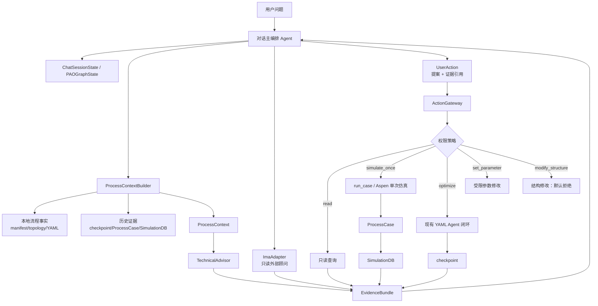

# PAO 外部 IMA 顾问与受控动作公共接口设计

## 1. 范围与现状基线

本阶段只定义公共接口、数据契约和调用边界，不连接真实 IMA，不改变现有 CLI、Aspen 驱动、优化闭环或 LangGraph 运行流程。接口包位于 `src/agents/evidence/`，只依赖 Python 标准库。

当前系统可以分成四层：

1. **入口与路由**：CLI 进入 `src/main.py`；Coordinator 按 `intent.py → planner.py → dispatcher.py` 完成意图识别、任务拆解和顺序分发。`ChatSessionState` 跨轮保存 Aspen、配置 YAML、结果 DB 等路径，不保存数值结果。
2. **对话/状态机**：`src/agents/graph.py` 的 `PAOGraphState` 用基本 Python 类型连接 onboarding、人工确认、优化、分析和结束节点；LangGraph checkpoint 负责状态恢复，首次草案确认是现有 HITL 边界。
3. **闭环优化**：YAML Agent 在 `agent_entry.py` 构造上下文和知识，在 `agent_optimize.py` 中执行 observe/decide/ask/evaluate/tell。`ActionPlan` 仅允许 `continue`、`set_region`、`probe`、`stop`，并由确定性校验器检查证据、边界、类型和预算。
4. **执行与证据**：Aspen COM 由 `src/aspen_driver/` 封装；`run_case()` 产生 `ProcessCase`；checkpoint 是闭环恢复的权威记录，`SimulationDB` 是查询、报表和离线分析投影。

## 2. 公共调用图



**调用顺序**：主编排先建立只读 `ProcessContext`，并行请求 IMA 与本地/历史证据；技术顾问只给出带证据的建议；主编排将建议转换为 `UserAction` 提案；动作网关重新校验权限、确认状态、边界和证据后才可调用现有执行链。任何执行结果重新包装成证据，不直接当作因果结论。

## 3. 公共模型

所有模型都是独立 dataclass，可 `to_dict()/from_dict()` 或 `to_json()/from_json()`。输入采用严格字段检查，未知字段直接拒绝；`None` 表示未知/不可用，不表示零或否。枚举在 JSON 中使用稳定字符串值。

### 3.1 `ImaAnswer`

| 字段 | 含义、来源与生命周期 |
|---|---|
| `answer` | IMA 的自然语言/结构化摘要；来自 `ImaAdapter.ask`，允许为空（错误或部分响应）。 |
| `source` | IMA 实例、知识库或请求通道标识；由 Adapter 提供。 |
| `confidence` | 0–1 置信度；由 IMA 返回或 Adapter 映射，不能伪造为本地验证结果。 |
| `assumptions` | IMA 明示或 Adapter 解析出的前提。 |
| `errors` | 超时、鉴权、解析或服务错误；与 `answer` 同时保留。 |
| `evidence` | 可引用的 `EvidenceItem`，来源固定为 `ima` 或由 Adapter 明确标注。 |
| `request_id/received_at` | 外部追踪信息；用于审计，不参与工艺结论。 |

生命周期：单次请求创建 → 加入 `EvidenceBundle` → 写入对话审计/checkpoint（若上层选择持久化）→ 不可变引用。

### 3.2 `ProcessContext`

| 字段 | 来源与说明 |
|---|---|
| `model_id/model_version` | Aspen 文件/manifest 的逻辑身份和版本或哈希；不暴露 COM 对象。 |
| `equipment/streams/topology` | Aspen topology、manifest 或本地扫描结果；结构化为普通 dict/list。 |
| `variables` | YAML design variables、工程硬边界、单位、可写性和依赖元数据。 |
| `objectives/constraints` | YAML 配置中的目标和约束定义；不允许由 IMA 改写。 |
| `current_values` | 当前只读快照，可来自已完成 `ProcessCase` 或显式读取。 |
| `history_evidence` | checkpoint 中的决策/观察摘要、`ProcessCase` 和 SimulationDB 记录引用。 |
| `sources` | 生成字段的完整来源索引（文件、case id、session id 等）。 |
| `session_id/generated_at` | 会话路由和快照时间。 |

生命周期：每次对话轮或动作前由 Builder 新建快照；不回写 `ChatSessionState`、`ProcessCase` 或 Aspen。数值结果仅来自本地记录/明确读取，不由对话记忆推断。

### 3.3 `TechnicalAdvice`

| 字段 | 含义、来源与生命周期 |
|---|---|
| `conclusion/mechanism` | 顾问的结论和机理解释；由本地顾问或 IMA 整理，不代表已执行。 |
| `evidence` | 支持结论的证据引用；必须能回指当前 `EvidenceBundle`。 |
| `risks` | 过程、设备、数据和执行风险；供主编排生成动作预览。 |
| `suggested_checks/suggested_experiments` | 下一步只读检查或受控实验建议；不会自动执行。 |
| `uncertainty/confidence` | 对适用性和可信度的显式表达；冲突或证据不足时不能标为低不确定性。 |
| `assumptions/conflicts` | 前提和未解决冲突；随建议一起审计。 |

生命周期：由顾问按当前 context/bundle 生成 → 主编排展示并可能转为 `UserAction` 提案 → 与对应 bundle 一起留存；建议对象本身不授予执行权限。

### 3.4 `EvidenceBundle`

| 字段 | 含义、来源与生命周期 |
|---|---|
| `ima` | 本轮 IMA 回答及其证据；来自 `ImaAdapter`。 |
| `local_process_facts` | manifest、拓扑、YAML、会话路径等本地事实。 |
| `simulation_evidence` | `ProcessCase`、checkpoint 或 `SimulationDB` 的只读摘要。 |
| `technical_advice` | 顾问输出及其证据引用。 |
| `conflicts/missing/complete` | 冲突、缺失项和完整性状态；由证据汇聚器计算，不由 IMA 单方面声明。 |
| `bundle_id` | 本轮证据包版本，用于绑定动作确认和审计。 |

生命周期：每次回答/动作前组装 → 主编排消费 → 随回答、动作提案和执行结果保存为审计快照；新一轮生成新 bundle，不原地改写旧证据。

### 3.5 `UserAction`

| 字段 | 含义、来源与生命周期 |
|---|---|
| `action_type/target` | 受控动作类别和目标变量/资源；由主编排生成，网关重新校验。 |
| `old_value/new_value` | 修改前后值；来自 context 或用户提案，未读取时 `old_value` 可为空。 |
| `reason/risks` | 技术理由和风险摘要；必须来自 advice/evidence。 |
| `confirmation_status` | `not_required`、`required`、`confirmed` 或 `rejected`；默认 `required`。 |
| `evidence_ids` | 支持动作的证据 ID；必须属于当前 bundle。 |
| `action_id` | 幂等和审计标识；确认、执行和结果必须使用同一 ID。 |

生命周期：主编排生成提案 → 人工确认或拒绝 → 网关 preview/execute → 记录结果并冻结原提案。配置、模型或 bundle 变化会使未执行确认失效。

## 4. 适配器与职责边界

`ImaAdapter.ask(question, context) -> ImaAnswer` 是唯一外部 IMA 边界。适配器不得泄漏 SDK 对象、写入 Aspen 或修改本地配置；未接入阶段可用 fake/stub 实现。

`ProcessContextBuilder.build(session, model_id) -> ProcessContext` 负责把 `ChatSessionState`、`PAOGraphState`、Aspen manifest/topology、YAML 配置、checkpoint 和 `SimulationDB` 摘要投影为快照。Builder 不执行仿真。

`TechnicalAdvisor.advise(context, evidence) -> TechnicalAdvice` 只分析证据，不调用执行网关。它可以提出参数检查或实验建议，但不能直接修改 `ActionPlan`、YAML 或 Aspen。

主编排 Agent（类型骨架中的 `ConversationOrchestrator`）负责：意图澄清、证据收集、冲突呈现、建议总结和生成 `UserAction` 提案。它可以复用 Coordinator 的 `IntentClassification/Plan/ExecutionState` 作为内部路由结果，但新公共契约不依赖这些类型。

`ActionGateway.preview/execute` 是唯一受控动作入口。网关必须重新读取上下文、校验来源和策略，并记录 action id、确认人、执行结果和失败原因。

## 5. 权限矩阵与人工确认

| 动作 | 允许范围 | 默认确认 |
|---|---|---|
| `read` | 读取 manifest、topology、YAML、checkpoint、SimulationDB、已完成 case；不得触发 COM 写入或仿真。 | 不需要；错误和不确定性仍需展示。 |
| `set_parameter` | 仅修改已声明、可写的设计变量；必须满足 YAML 工程硬边界、类型、依赖和单位检查；不得改目标、约束、物性或任意 Aspen 路径。 | **必须人工确认**；确认前只允许 preview。 |
| `simulate_once` | 使用已确认配置执行一次 `run_case()`；参数来自已确认 action，结果写入 `ProcessCase`/SimulationDB。 | **必须人工确认**，每次单独确认。 |
| `optimize` | 只能调用现有 YAML Agent/`ActionPlan` 闭环；预算、search region、checkpoint 指纹和验证规则保持不变。 | **必须人工确认**，并确认配置、模型、预算和目标。 |
| `modify_structure` | 修改设备、连接、流程拓扑、物性模型、反应动力学或目标/约束定义。 | **禁止由本接口直接执行**；只能生成需工程师审查的设计变更说明。 |

确认必须绑定 `action_id`、目标、原值/新值、风险摘要、证据 bundle 版本和会话；配置或模型发生变化后确认失效。被拒绝或过期的动作不可自动重试。

## 6. 不确定性、来源和冲突规则

- 每个事实或结论都应有 `EvidenceItem.id`、`source`、`source_ref` 和可选 `confidence/uncertainty`。
- IMA 的回答只能作为 `ima` 证据；本地事实、仿真结果和技术建议分栏保存，不能混写为一个“可信结论”。
- 仿真未收敛、目标/约束不可用、样本不足时必须保留原始状态；不得填零或把失败样本当作可行证据。
- 同一变量或结论出现不同单位、时间、模型版本或数值时，加入 `conflicts`，并列出建议检查；主编排可选择保守停止，但不能静默覆盖来源。
- `TechnicalAdvice.uncertainty` 只能由证据覆盖度、模型适用性和冲突情况支持；一次实验前后指标变化只表示观察到的关联，不自动宣称因果。

## 7. 可复用结构与后续依赖

- `ChatSessionState`：复用会话级 Aspen/config/DB 路径和轮次；不扩展其数值记忆语义。
- `PAOGraphState`：后续可增加契约对象的序列化字段或引用，但本阶段不修改 graph。
- `ProcessCase`：作为 simulation evidence 的权威来源；用 `case_id/status/objectives/constraints/design_vars/tags` 建立 `EvidenceItem.source_ref`。
- `ActionPlan`：继续作为 YAML Agent 的内部优化协议；由主编排提出的 `UserAction(action_type=optimize)` 只能请求现有入口，不替代 ActionPlan 校验器。
- checkpoint：保存闭环恢复所需的 pending、observations、decisions、fingerprint 和预算；新层只保存引用或审计包，不能把 IMA/COM 对象序列化进去。
- `SimulationDB`：只读查询和报表投影；不承担动作授权，也不替代 checkpoint。

后续阶段依赖：真实 IMA Adapter 的鉴权/超时/限流协议；ProcessContextBuilder 的 manifest 字段映射；ActionGateway 的策略实现和审计表；LangGraph 节点如何保存 bundle/action 引用；以及人工确认 UI/CLI 的交互格式。

## 8. 文件与验证

新增文件：

- `src/agents/evidence/__init__.py`
- `src/agents/evidence/models.py`
- `src/agents/evidence/protocols.py`
- `tests/agents/contracts/test_models.py`
- `docs/agent_conversation_architecture.md`

验证命令：

```powershell
python -m pytest tests/agents/contracts/test_models.py -q
```

结果：4 passed。测试覆盖 IMA、ProcessContext、TechnicalAdvice、EvidenceBundle、UserAction 的嵌套序列化/反序列化、枚举边界和未知字段拒绝；不需要 Aspen、IMA 服务或外部 SDK。
